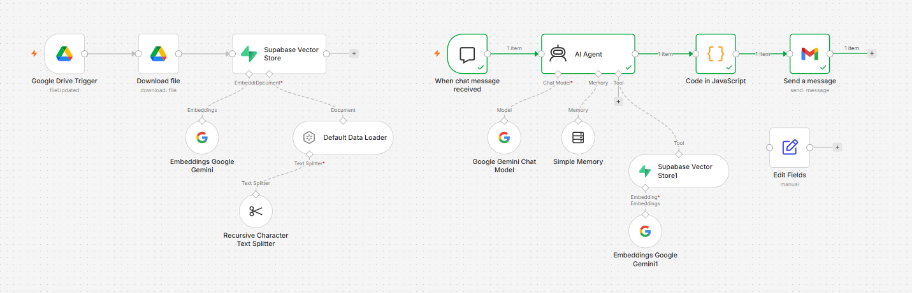
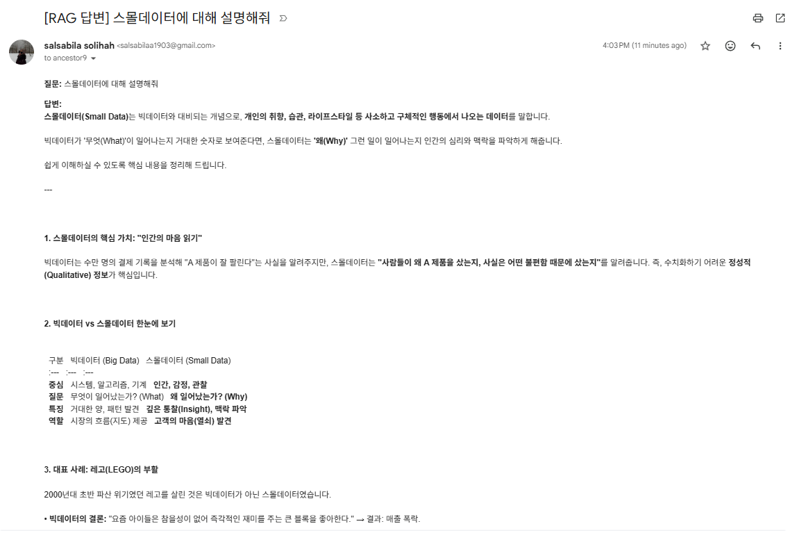

# Automated RAG Pipeline: Small Data (스몰데이터) Analysis & Automated Email Reporting

A robust, end-to-end **Retrieval-Augmented Generation (RAG)** automated workflow built with **n8n**, **Supabase Vector Store**, **Google Gemini AI**, and **Gmail API**. This pipeline automatically ingests reference documents, processes vector embeddings, handles user queries, formats structured outputs via custom JavaScript, and delivers professional email reports directly to academic faculty.

---

## Architecture & Workflow Overview

The complete automation workflow moves seamlessly from document ingestion on the left to query processing and automated email dispatch on the right:

1. **Google Drive Trigger & Download:** Automatically monitors and downloads the reference PDF document (*'미래AI기술.pdf'*) whenever it is updated.
2. **Text Splitting & Vector Store:** Breaks down the document using a *Recursive Character Text Splitter*, generates embeddings via Google Gemini, and stores them in Supabase for efficient similarity search.
3. **Chat Trigger & AI Agent:** Captures the user prompt (`스몰데이터에 대해 설명해줘`), queries the Supabase vector store, and generates a precise answer using the Gemini LLM.
4. **Code in JavaScript:** Intercepts raw AI markdown output and dynamically converts it into clean, well-spaced HTML formatting.
5. **Send a Message (Gmail) [Automated]:** Automatically attaches the required subject line, formats the structured body, and dispatches the final report directly to the professor's email (`ancestor9@kbu.ac.kr`) without manual intervention.

---

## Visual Workflow Architecture

---

## Sample Output Email Preview
The automated output email rendered cleanly via HTML formatting, ensuring high readability and compliance with academic submission standards:

---

## Prerequisites & Tech Stack
* **Workflow Engine:** n8n (Self-hosted or Cloud)
* **Vector Database:** Supabase (with pgvector extension)
* **LLM & Embeddings:** Google Gemini API (Chat Model & Embeddings)
* **Integration API:** Google Drive API & Gmail API

---

## Setup & Deployment Guide
1. **Clone / Download:** Download the `workflow.json` file from this repository.
2. **Import Workflow:** Open your n8n dashboard, click **Add workflow** -> **Import from File**, and select `workflow.json`.
3. **Configure Credentials:** Reconnect or provide API keys for Google Drive, Google Gemini, Supabase, and Gmail.
4. **Execute & Test:** Open the chat trigger, enter your target prompt (`스몰데이터에 대해 설명해줘`), and run the workflow to test automated reporting.
